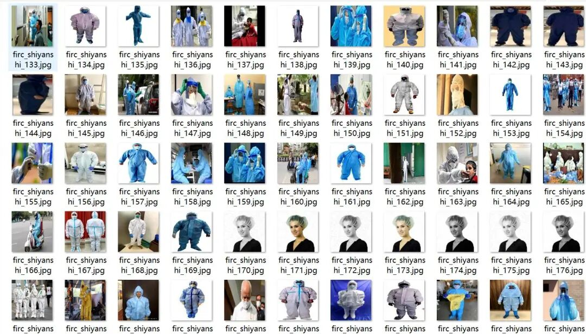
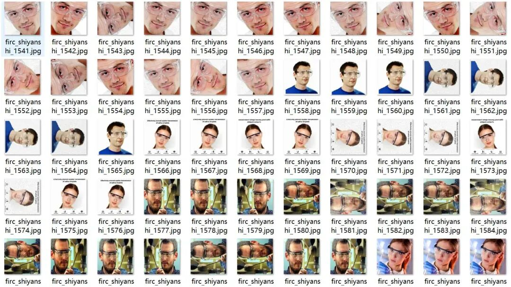
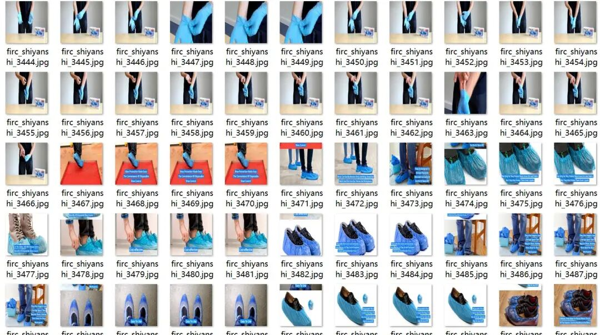
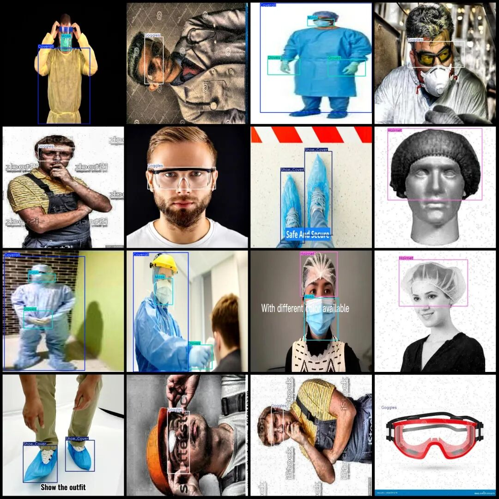

# Dataset of Laboratory Safety Behavior Detection in VOC+YOLO format with 3996 images across 6 categories

Please note that the dataset images include a large number of enhanced versions, and some video clips appear somewhat repetitive.

Please note that the dataset images include a large number of enhanced versions, and some video clips appear somewhat repetitive.

Dataset format: Pascal VOC format + YOLO format (txt file without split path, only containing jpg images and corresponding VOC format xml files and yolo format txt files)

Number of images (number of jpg files): 3996

Number of annotations (number of xml files): 3996

Number of annotations (number of txt files): 3996

Label count: 6

Label category names (note that the order of categories in the YOLO format does not correspond to this, but is based on the labels folder's classes.txt): ["Coverall", "Gloves", "Goggles", "Hairnet", "Mask", "Shoe_Cover"]

Number of boxes labeled in each category:

Coverall Frame Count = 1348

Gloves Frame Count = 1971

Goggles frame count = 2611

Hairnet Frame Count = 698

Mask Frame Count = 1560

Shoe_Cover Frames = 636

Total frame count: 8824

Using labelImg:

Annotation rules: Draw a rectangle around the category.

Important Notice: No

Image resolution: 640x640

Is the dataset enhanced? There are many enhanced images.

Special : This dataset does not guarantee the accuracy of the trained models or weight files.

Image Preview:

Annotation example:

## Payment

Here is a pay link on Stripe ( https://buy.stripe.com/3cs8yP7sY87d0vu9AB ). Please contact me lonlonago@foxmail.com after funding $89, and I will send you a complete data files , thank you!

